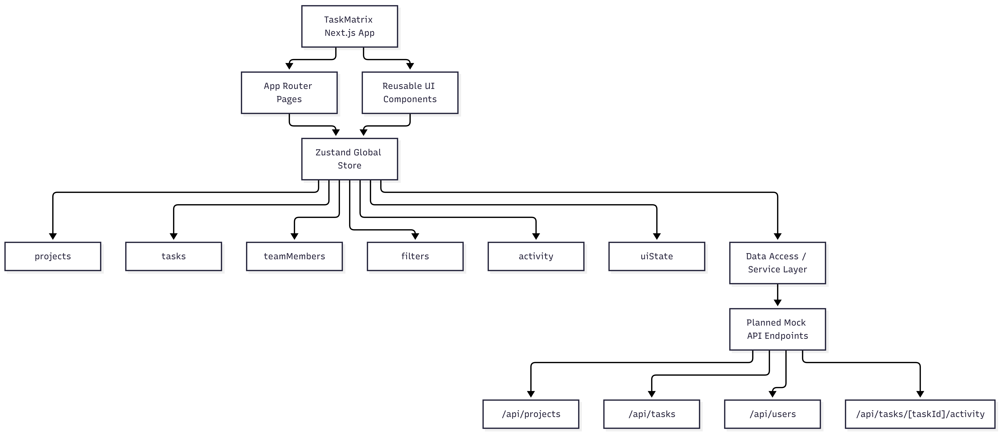

# TaskMatrix — Agile Project Management

## 1. Project Overview

TaskMatrix is a web-based Agile project management application designed to help teams organize projects, assign tasks, track progress, and manage deadlines through a simple and responsive Kanban board.

The project is being developed as part of the Prodesk IT Capstone. This Sprint 13 submission focuses on product planning, UI/UX wireframes, frontend architecture, state management, and technical documentation. Functional application development will begin in the following sprint.

## 2. Problem Statement

Teams often struggle to manage tasks across different projects, understand current work status, track deadlines, and identify pending tasks. TaskMatrix aims to provide a centralized workspace where users can view projects, organize tasks by status, assign team members, and monitor progress.

## 3. Project Goals

- Provide a clear dashboard for project and task overview.
- Organize tasks using a Kanban board.
- Support task creation, editing, assignment, and deletion.
- Allow users to search, filter, and sort tasks.
- Provide a responsive experience on desktop, tablet, and mobile.
- Maintain a clear and scalable frontend architecture.

## 4. Target Users

- Project managers who organize work and monitor progress.
- Developers and designers who manage assigned tasks.
- Small teams following Agile workflows.
- Students coordinating group projects and assignments.

## 5. Project Track

**Selected Project:** TaskMatrix — Agile Project Management  
**Selected Track:** Frontend Specialist

The primary focus is frontend development, reusable components, responsive design, client-side state management, and integration with planned API endpoints.

## 6. Core Features and Priorities

### P0 — Core MVP Features

- Dashboard with project and task summaries.
- Project listing and project details.
- Kanban board with To Do, In Progress, and Done columns.
- Create, view, edit, and delete tasks.
- Assign tasks to team members.
- Task priority and due-date fields.
- Search and filter tasks by status and priority.
- Client-side state management and persistence.

### P1 — Usability Improvements

- Task details panel.
- Responsive mobile navigation and layouts.
- Loading, empty, and error states.
- Deadline indicators.
- Task activity history.
- Sorting and improved filtering controls.

### P2 — Future Enhancements

- Real-time task updates.
- In-app notifications.
- Project analytics.
- Optional AI-powered task summaries.

P2 features are outside the initial MVP scope unless time permits.

## 7. Technology Stack

- **Framework:** Next.js with App Router
- **Language:** JavaScript
- **Styling:** Tailwind CSS
- **UI Components:** shadcn/ui
- **Global State:** Zustand
- **Icons:** Lucide
- **Initial Persistence:** Mock data with LocalStorage
- **Planned API Integration:** Next.js Route Handlers
- **Design and Wireframes:** Figma
- **Architecture Diagrams:** Mermaid
- **Version Control:** Git and GitHub
- **Deployment Target:** Vercel

The final persistence approach will be reviewed during implementation. Mock data and LocalStorage will be used for the initial MVP unless the project requirements require a different solution.

## 8. Planned Application Screens

### 8.1 Dashboard

- Overview of projects and tasks.
- Task counts by status.
- Upcoming deadlines.
- Quick navigation to projects.

### 8.2 Projects Page

- List of available projects.
- Project name and description.
- Project progress summary.
- Navigation to a selected project board.

### 8.3 Kanban Board

- To Do, In Progress, and Done columns.
- Task cards with title, priority, assignee, and due date.
- Search, filter, and sorting controls.
- Task creation and editing actions.

### 8.4 Task Details

- Task title and description.
- Status and priority.
- Assignee and due date.
- Task activity history.
- Edit and delete actions.

### 8.5 Responsive Layout

The interface will be planned for desktop, tablet, and mobile. On smaller screens, navigation and board layouts will adapt to the available width.

## 9. Frontend Architecture

The application will use the Next.js App Router to organize pages and layouts. Reusable components will handle common interface elements, while Zustand will manage shared client-side state.

Planned global state:

- `projects` — project list and active project.
- `tasks` — task records and selected task.
- `teamMembers` — users available for task assignment.
- `filters` — search, status, priority, and sorting settings.
- `activity` — task activity history.
- `uiState` — loading, error, and notification states.

Components will use the store where shared state is required. Data access will be organized separately so the initial mock-data implementation can later be connected to API endpoints.

## 10. Planned Mock API Endpoints

The following endpoints are planned for future implementation. They are not implemented as part of Sprint 13 planning.

| Method | Endpoint | Purpose |
|---|---|---|
| GET | `/api/projects` | Retrieve projects |
| POST | `/api/projects` | Create a project |
| GET | `/api/projects/[projectId]` | Retrieve project details |
| GET | `/api/projects/[projectId]/tasks` | Retrieve project tasks |
| POST | `/api/tasks` | Create a task |
| PATCH | `/api/tasks/[taskId]` | Update a task |
| DELETE | `/api/tasks/[taskId]` | Delete a task |
| GET | `/api/users` | Retrieve team members |
| GET | `/api/tasks/[taskId]/activity` | Retrieve task activity |

## 11. State Architecture Diagram

The planned state architecture will show how Next.js pages and reusable UI components interact with the Zustand store and the planned API service layer.

**Diagram:**

The exported diagram will be added to this repository after the architecture diagram is created.

## 12. UI/UX Design and Wireframes

Wireframes will be created in Figma for the following views:

1. Dashboard — desktop and mobile.
2. Kanban Board — desktop and mobile.
3. Task Details — desktop and mobile.

The design will prioritize clarity, consistent spacing, readable task cards, visible status labels, accessible controls, and responsive layouts.

**Public Figma Link:** To be added after the wireframes are created and sharing permissions are enabled.

## 13. Non-Functional Requirements

- Responsive layouts across common screen sizes.
- Reusable and maintainable components.
- Clear loading, empty, and error states.
- Accessible labels and keyboard-friendly controls where applicable.
- Consistent UI patterns and readable typography.
- Separation of presentation, state management, and data access.

## 14. Development Roadmap

- **Sprint 13 — Planning:** PRD, technology stack, wireframes, architecture diagram, and AI prompt documentation.
- **Sprint 14 — MVP:** Build the initial responsive interface and core project/task views.
- **Sprint 15 — CRUD:** Implement and test project and task creation, editing, and deletion.
- **Sprint 16 — Integration and Polish:** Add planned AI integration if approved, improve UX, and handle edge cases.
- **Sprint 17 — Delivery:** Configure CI/CD, deploy the application, and complete final testing.

## 15. Out of Scope for the Initial MVP

- Payment processing.
- Video conferencing.
- Full team chat system.
- Complex enterprise automation.
- Enterprise single sign-on.
- Advanced AI workflows.

## 16. AI Usage and Documentation

AI tools may be used to support planning, architecture exploration, documentation, and debugging. Important architectural decisions and relevant AI prompts will be documented in `Prompts.md`.

All generated or suggested code will be reviewed and understood before implementation. Project decisions and implementation status will be documented honestly.

## 17. Current Project Status

**Current Phase:** Sprint 13 — Capstone Planning

Planning deliverables include the PRD, UI/UX wireframes, frontend state architecture, planned API contracts, and AI prompt documentation.

Functional application code, API implementation, and deployment are planned for later sprints.

